# Slova Blog — a free blog for Magento 2 on Hyvä

A blog for Magento 2 stores on Hyvä that writes like WordPress and loads like the rest of your Hyvä store. Preview a post before you save it, keep drafts, show your products inside your stories, and get WebP images, structured data and zero layout shift without extra work. Free, MIT-licensed, no account and no external service.

It started as the blog of [caruselbooks.ro](https://caruselbooks.ro), a children's book publisher, and was made generic for any store.

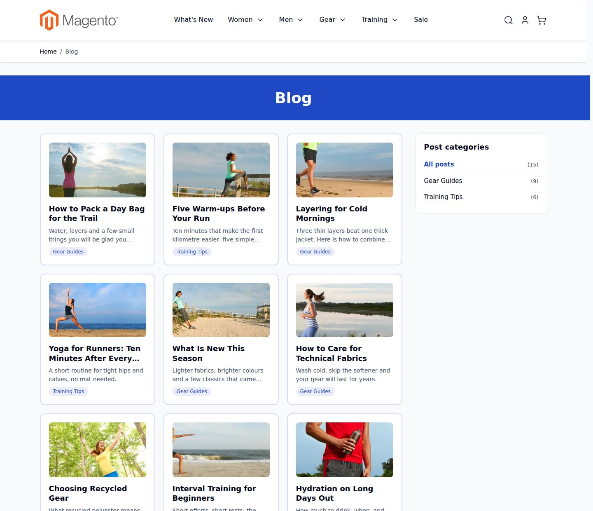

<sub>All screenshots: stock Hyvä theme with Magento's sample data. Your theme's colors and fonts apply automatically.</sub>

## Contents

- [Requirements](#requirements) · [Installation](#installation) · [Quick start](#quick-start)
- [What makes it different](#what-makes-it-different)
- [Writing a post, step by step](#writing-a-post-step-by-step)
- [Preview, Save Draft and View Post](#preview-save-draft-and-view-post)
- [Categories](#categories)
- [What visitors see](#what-visitors-see)
- [The blog on your home page](#the-blog-on-your-home-page)
- [Settings](#settings)
- [URLs](#urls) · [SEO](#seo) · [Images and speed](#images-and-speed)
- [Customizing](#customizing) · [For developers](#for-developers) · [Troubleshooting](#troubleshooting)
- [Upgrading and uninstalling](#upgrading-and-uninstalling) · [More from Slova](#more-from-slova) · [License](#license)

## Requirements

| | |
|---|---|
| [Magento Open Source](https://business.adobe.com/products/magento/open-source.html) | 2.4.8 (tested on 2.4.8-p5) |
| [Hyvä Theme](https://www.hyva.io/) | 1.4 or newer (tested on 1.5.3) |
| PHP | 8.3 – 8.4, with the GD (WebP support) and intl extensions |

`hyva-themes/magento2-theme-module` comes from Hyvä's own Composer repository, which every Hyvä store already has. Adobe Commerce has not been tested yet.

## Installation

```bash
composer require slova/module-blog
bin/magento module:enable Slova_Blog
bin/magento setup:upgrade
bin/magento setup:di:compile          # production mode only
bin/magento cache:flush
```

## Quick start

1. **Create a category** under *Content → Blog → Categories* (for example "News").
2. **Write a post** under *Content → Blog → Posts → New Post*: a title, a short description, some content and a featured image. Press *Preview* to see it, then *Save*.
3. **Open `/blog`** on your store: the post is there.
4. **Link the blog** from your menu or footer, and [add the latest posts to your home page](#the-blog-on-your-home-page).
5. **Review the settings** under *Content → Blog → Settings*: blog title, URL, colors.

## What makes it different

**Writing feels like WordPress.**
- **Preview with unsaved changes.** Press *Preview* and the post opens in a new tab exactly as it is in the editor, before you save anything. Magento Open Source has no preview, not even for its own CMS pages.
- **Drafts that save themselves.** *Save Draft* keeps a post off the site while you work on it. On a draft, *Preview* saves it first, so nothing is lost if you close the tab.
- **Previewing never touches a live post.** Visitors keep seeing the saved version until you press Save.
- **View Post** jumps to the public page, and every post can be **scheduled** with a future publish date.

**Every post looks finished, whatever pictures you have.**
- **The featured image does two jobs.** It is the post's card in the lists and, if you want, a wide banner (hero) at the top of the post.
- **An intro section replaces the hero** when your picture is not wide: a book cover, a product shot or a portrait sits next to a short text at its natural size, instead of being squeezed into a banner.
- **A separate square image for phones**, when the wide one does not read well on a small card.
- **Each image is shown once per page.** If the featured image is also in the text, the banner is left out automatically.

**Built to sell.**
- **Products inside the story.** List SKUs and a slider of Hyvä product cards (price, Add to Cart, wishlist) appears under the post.
- **The blog on your home page** with a standard Magento widget: the newest posts, all or from one category.

**Fast and clean, with no extra work.**
- **Zero layout shift.** Measured CLS: 0 on the list and on posts, on desktop and on a phone-sized screen.
- **WebP images sized for every screen**, including the pictures you insert inside the text.
- **Videos load nothing until clicked.** `[youtube:VIDEO_ID]` shows a thumbnail instead of loading YouTube's player, its scripts and its cookies.
- **Built for Hyvä.** Works with Alpine's CSP build, needs no Tailwind rebuild and follows your theme's colors.

**Search engines and links.**
- **Your own URLs** per store view (`/blog`, `/news`, `/journal`…). Old internal links redirect with a 301.
- **SEO built in.** `Article` and `BreadcrumbList` structured data, canonical links, Open Graph and Twitter Card tags, and the posts in Magento's XML sitemap.
- **English and Romanian** included.

**What it does not do:** authors, comments and tags; separate content per store view (one set of posts serves all store views); Page Builder; GraphQL; Luma storefronts.

## Writing a post, step by step

*Content → Blog → Posts → New Post.* The form follows the order you write in: words first, then pictures, then where the post goes.

### 1. Title, URL key and short description

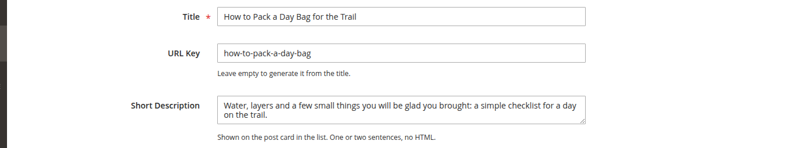

| Field | What it does on the storefront |
|---|---|
| **Title** | The post's heading (the only `<h1>` of the page), the card title, the browser tab and the last breadcrumb. |
| **URL Key** | The last part of the address: `/blog/how-to-pack-a-day-bag`. Leave it empty and it is made from the title, with accents turned into plain letters (`Știri și noutăți` → `stiri-si-noutati`). |
| **Short Description** | The two lines under the title on the card, and the meta description when you leave the SEO one empty. Plain text. |

### 2. Content

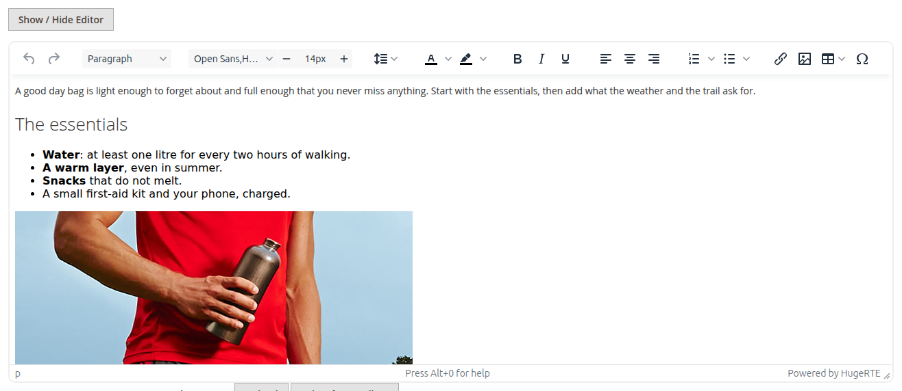

The content is a standard Magento WYSIWYG editor (Page Builder is turned off on purpose: posts stay light and portable). You can:

- format text, headings, lists, links and quotes;
- **insert images** from the media gallery or upload them. They are resized and served as WebP automatically (see [Images and speed](#images-and-speed));
- **add a YouTube video** by typing its ID in square brackets, on a line of its own:

  ```text
  [youtube:aqz-KE-bpKQ]
  ```

  The ID is the part after `v=` in the video's address (`https://www.youtube.com/watch?v=aqz-KE-bpKQ`).

**Why a shortcode and not YouTube's embed code?** A normal YouTube embed loads the player, its scripts and its cookies on every visit, before anyone clicks. That costs speed and, in the EU, needs cookie consent. The shortcode shows the video's thumbnail with a play button; nothing from YouTube loads until the visitor clicks, and the video then opens on YouTube. A pasted YouTube or Vimeo `<iframe>` still works, and is lazy-loaded.

On the storefront:

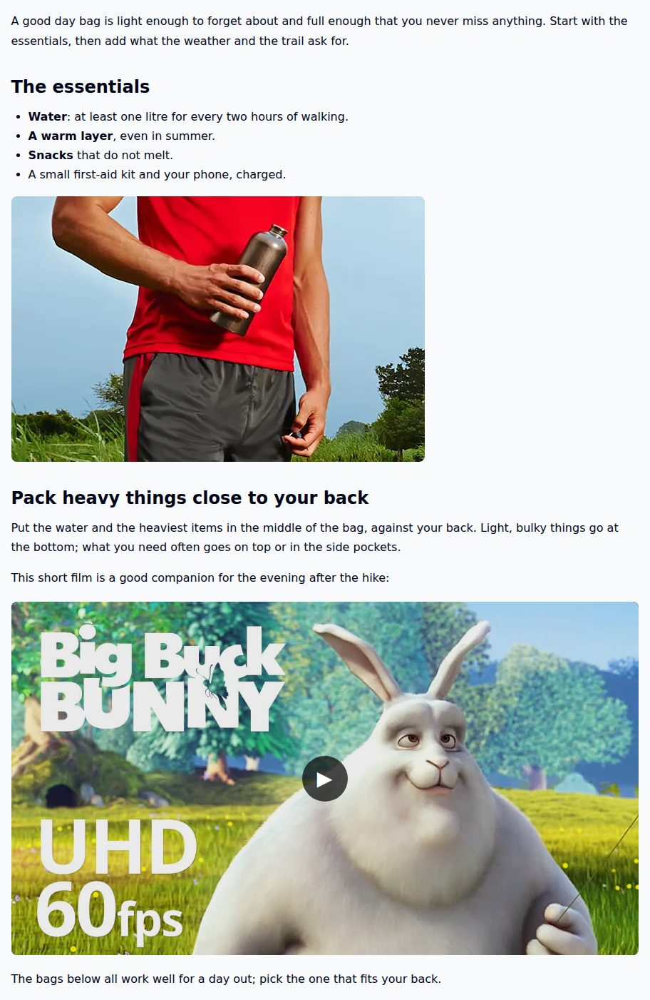

### 3. Featured image, mobile thumbnail and the hero switch

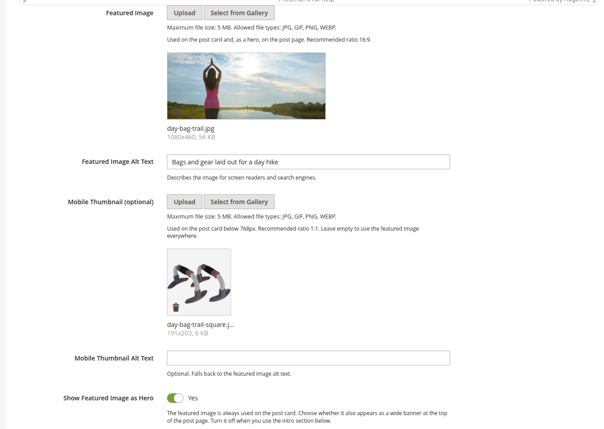

| Field | Where it appears |
|---|---|
| **Featured Image** | ① The post's **card** in the blog lists and in the home page widget. ② The **hero**: a wide banner (21:9) at the top of the post, unless switched off below. ③ The **share image** on Facebook, WhatsApp, LinkedIn… when no Open Graph image is set. |
| **Featured Image Alt Text** | Describes the image for screen readers and search engines. |
| **Mobile Thumbnail** (optional) | Replaces the featured image on **cards below 768 px** (phones), where the card is a small square next to the title. Use it when the wide image does not read well that small; a square image works best. |
| **Show Featured Image as Hero** | On: the featured image is also the banner at the top of the post. Off: it stays on the card only. |

**How the card frame is filled.** Card images sit in a 16:9 frame (a square on phones). By default they **fill** it: the image is scaled until the frame is covered and the rest is cropped, keeping the top of the picture, so heads are not cut off; every card then has the same margin on all sides of its picture. A very wide picture loses a lot on the sides in the square phone frame: give such posts a mobile thumbnail. If your card images must never be cropped (book covers, product photos on a transparent background), set **Card Images** to *Show the whole image* in the [settings](#settings).

The hero on the storefront:

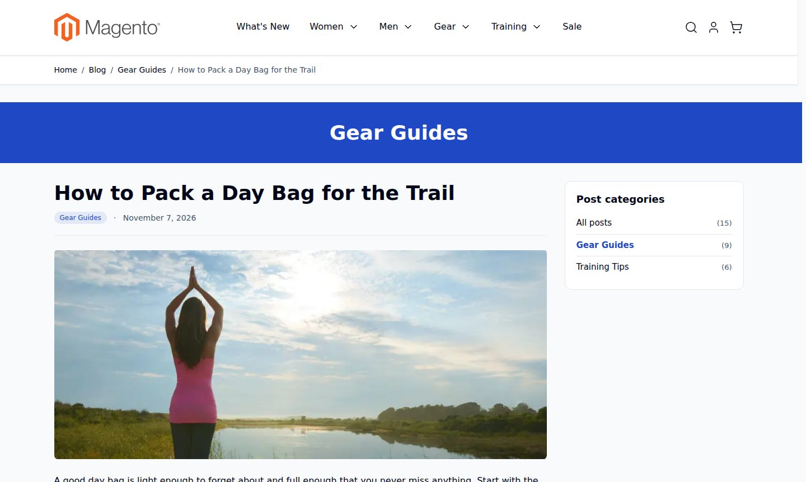

**Why can the hero be switched off?** The same picture rarely works both as a card and as a wide banner. A landscape photo is perfect for both; a book cover, a product shot or a portrait makes a good card but a poor 21:9 banner (it shows up small, with empty space on both sides). Switching the hero off keeps the card and lets the post open with the [intro section](#4-intro-section-the-alternative-to-the-hero) or directly with the text.

**Each image once per page.** You do not have to remember the rule: if the featured image is also in the content, or is the intro image, the hero is left out automatically. The same photo uploaded twice under different names counts as the same image.

### 4. Intro section, the alternative to the hero

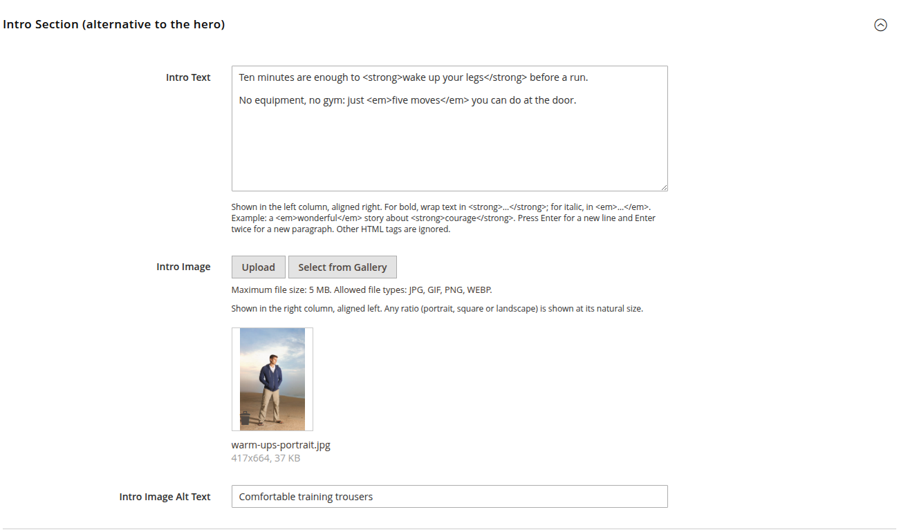

The intro section shows a short text and a picture side by side, above the content. It exists for posts whose main picture is not wide: the picture keeps its own shape (portrait, square or landscape) and its natural size, and the text gives it context.

| Field | What it does |
|---|---|
| **Intro Text** | Plain text, shown in the left column, aligned to the right (next to the picture). Wrap words in `<strong>…</strong>` for bold and `<em>…</em>` for italic; press Enter for a new line, Enter twice for a new paragraph. Any other HTML is shown as text, so a paste from Word cannot break the layout. |
| **Intro Image** | Shown in the right column at its natural size (up to 480 px high). |
| **Intro Image Alt Text** | For screen readers and search engines. |

With the hero switched off and an intro set, the post opens like this:

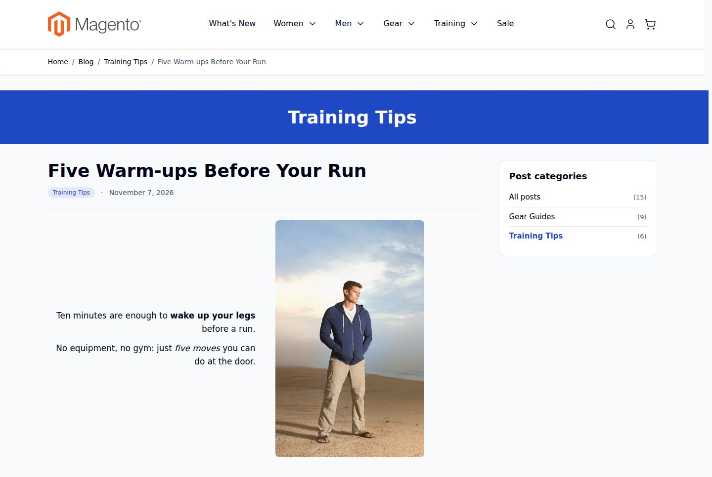

On phones the text and the picture stack. Either one can be left empty: text alone or a picture alone spans the full width.

### 5. Categories, related products and publishing

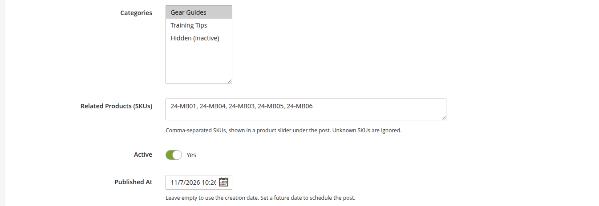

| Field | What it does on the storefront |
|---|---|
| **Categories** | Where the post is listed. A post can be in several; the **first** one is its main category: it is named in the breadcrumbs and the title band, highlighted in the category list, and used for the *Previous post / Next post* links. |
| **Related Products (SKUs)** | SKUs separated by commas or spaces, in the order you want them. They appear under the post as a slider of Hyvä product cards. Unknown SKUs are reported when you save; only enabled products visible in the catalog are shown. |
| **Active** | Off: the post is a draft, not visible anywhere. |
| **Published At** | Empty: the post shows its creation date. A date in the future **schedules** the post: it stays hidden until then. |

Under every post, the links to the previous and next post of the same category, then the products:

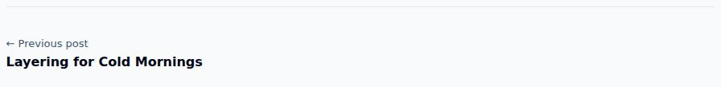

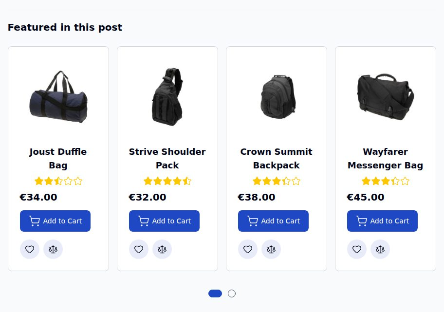

### 6. SEO

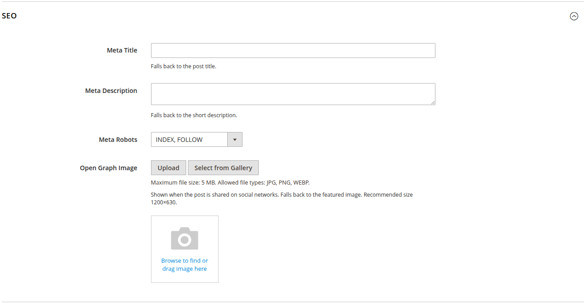

| Field | Default when empty |
|---|---|
| **Meta Title** | The post title. |
| **Meta Description** | The short description. |
| **Meta Robots** | `INDEX, FOLLOW`. Choose `NOINDEX` for posts you do not want in search results. |
| **Open Graph Image** | The featured image. Shown when the post is shared on social networks; 1200×630 works best. |

## Preview, Save Draft and View Post

The buttons at the top of the editor:


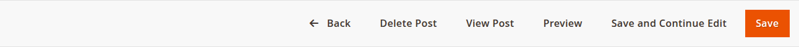

| Button | When it appears | What it does |
|---|---|---|
| **Preview** | always | Opens the post in a new tab **exactly as it is in the editor**, unsaved changes included. |
| **Save Draft** | new and inactive posts | Saves the post as inactive and keeps the editor open. |
| **View Post** | live posts (active, publish date reached) | Opens the public page in a new tab. |
| **Save** / **Save and Continue Edit** | always | Save with the *Active* switch as set in the form. |

What *Preview* does depends on the post:

- **A draft** (a new post, or one that is not active) is **saved first**, still inactive, then shown. Your work is never lost, and the next *Save* updates the same post.
- **A live post** is **never saved** by *Preview*. You see your changes; visitors keep seeing the saved version until you press *Save*.

The preview page carries a notice so nobody mistakes it for the public page:

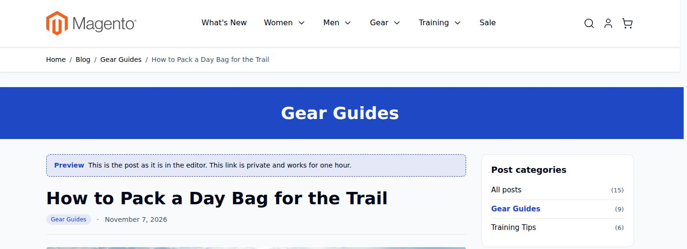

The preview link is private and stops working after one hour. It is not indexed by search engines and never stored in the page cache.

## Categories

*Content → Blog → Categories.*

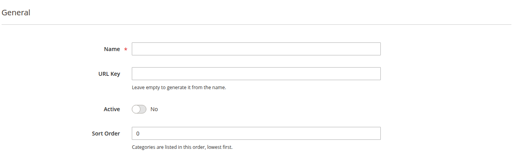

| Field | What it does |
|---|---|
| **Name** | Shown in the category list, on post cards, in breadcrumbs and in the title band. |
| **URL Key** | `/blog/category/news`. Made from the name when left empty. |
| **Active** | Off: the category page returns "not found" and the category is hidden from the lists (its posts stay visible elsewhere). |
| **Sort Order** | Order in the category list, lowest first. |

## What visitors see

**The blog home and category pages** show the posts as cards, newest first: three columns on desktop, two on tablets, one on phones. Larger screens get a pager; on phones the next posts load as the visitor scrolls.

The categories, with the number of posts in each, sit in the sidebar on desktop. Below 1280 px they become a dropdown above the posts:

| Phone | Categories open |
|---|---|
| 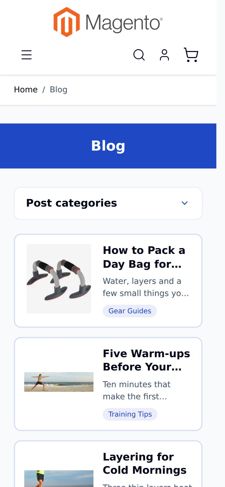 | 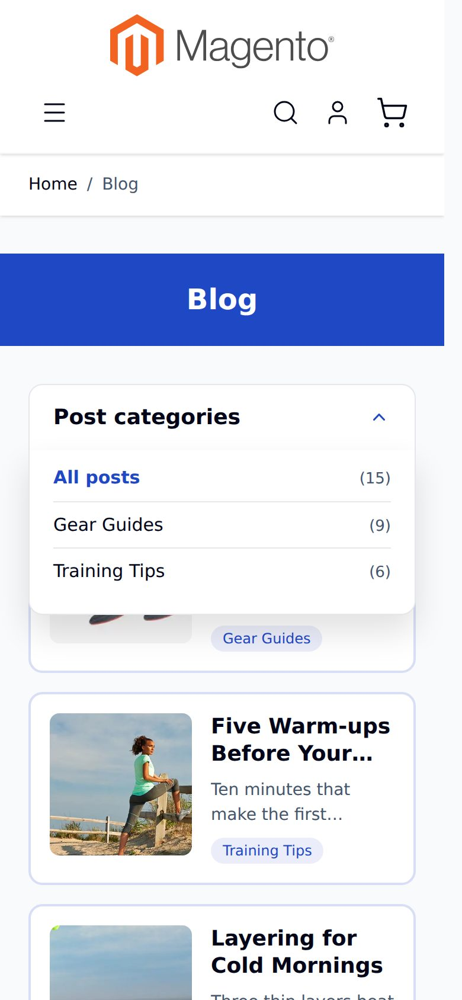 |

Note the first card on the phone: it uses the post's **mobile thumbnail** (square), while the desktop list uses the wide featured image.

**A post page** shows, from top to bottom:

1. the title band with the category name (can be switched off);
2. the title, the category labels and the date;
3. the intro section or the hero (or neither);
4. the content;
5. the previous / next links within the category;
6. the related products.

The sidebar shows the categories and, if you choose one in the settings, a CMS block (a promotion, a newsletter form…).

## The blog on your home page

The module adds a standard Magento widget, **Slova Blog: Latest Posts**: the newest posts as cards, with a "View all posts" link.

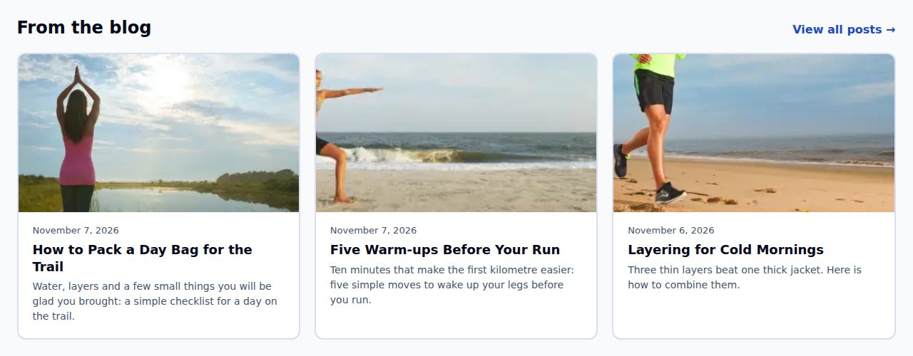

### Option A: Content → Widgets (recommended)

1. Go to **Content → Elements → Widgets → Add Widget**.
2. **Type:** *Slova Blog: Latest Posts*. **Design Theme:** your Hyvä theme. Press *Continue*.
3. **Storefront Properties:** a title for your own reference (for example "Home – latest posts"), the store views, and under *Layout Updates* → *Add Layout Update*: **Display on** *Specified Page* → *CMS Home Page*, **Container** *Main Content Area*.
4. **Widget Options:** fill them in (see the table below).

   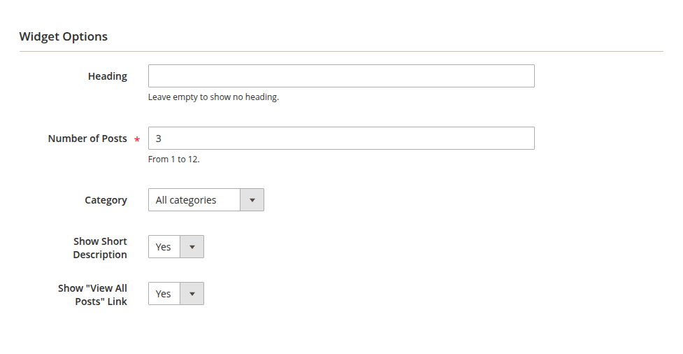

5. *Save*, then flush the cache (*System → Cache Management*).

### Option B: inside a CMS page or block

Open the page (for example *Content → Pages → Home Page*), place the cursor where the posts should appear and use *Insert Widget* in the editor, or paste:

```text
{{widget type="Slova\Blog\Block\Widget\LatestPosts" title="From the blog" posts_count="3" show_excerpt="1" show_link="1"}}
```

The same works in any CMS block, so you can put the latest posts on any page that shows that block.

### Widget options

| Option | Values | Effect |
|---|---|---|
| **Heading** | text | Shown above the cards. Empty: no heading. |
| **Number of Posts** | 1–12, default 3 | How many cards. They form one row of three on desktop, two on tablets, one on phones. |
| **Category** | All categories, or one | Only the newest posts of that category. The link then goes to the category page. |
| **Show Short Description** | Yes / No | The two-line description under each title. |
| **Show "View All Posts" Link** | Yes / No | A link to the blog (or to the category) next to the heading. |

The widget's cards use the featured image, cropped to 16:9, and take your accent color. The page cache is refreshed when a post is saved.

## Settings

*Content → Blog → Settings* (the same page as *Stores → Configuration → Slova → Blog*). Every setting can differ per store view.

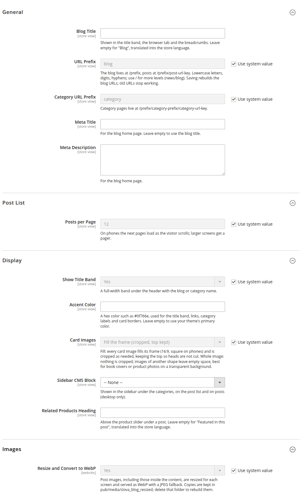

| Setting | Default | Effect on the storefront |
|---|---|---|
| **Blog Title** | "Blog", translated | The title band on the blog home, the browser tab, the breadcrumbs. |
| **URL Prefix** | `blog` | The blog's address: `/blog`, posts at `/blog/post-url-key`. Several levels are allowed (`news/blog`). **Choose it before you publish:** changing it later makes the old addresses stop working. See [URLs](#urls). |
| **Category URL Prefix** | `category` | Category pages at `/blog/category/category-url-key`. |
| **Meta Title** | the blog title | Browser tab and search results for the blog home. |
| **Meta Description** | empty | Search result snippet for the blog home. |
| **Posts per Page** | 12 | Cards per page on the blog home and category pages. |
| **Show Title Band** | Yes | The full-width colored band under the header. With No, the page shows its own heading instead. |
| **Accent Color** | your theme's primary color | A hex color such as `#0f766e` for the title band, links, category labels, card borders and the widget. |
| **Card Images** | Fill the frame | *Fill the frame*: card pictures cover their 16:9 frame (square on phones), cropped from the top down. *Show the whole image*: nothing is cropped; pictures of another shape leave empty space. Applies to the blog lists and the widget. |
| **Sidebar CMS Block** | None | A CMS block under the categories in the sidebar (desktop). |
| **Related Products Heading** | "Featured in this post", translated | The heading above the product slider. A bookshop might write "Books in this story". |
| **Resize and Convert to WebP** | Yes | Turn off to serve the uploaded files unchanged. |

## URLs

| Page | Address (default settings) |
|---|---|
| Blog home | `/blog` |
| Category | `/blog/category/{category URL key}` |
| Post | `/blog/{post URL key}` |

The addresses are URL rewrites built from the prefixes, written for every store view whenever a post or category is saved. Saving new prefixes in the settings rebuilds all of them. **Old addresses then stop working, so choose the prefix before you publish.** After adding a store view, or after changing a prefix with `bin/magento config:set`, rebuild them:

```bash
bin/magento slova:blog:url-rewrites
```

The internal routes (`/blog/post/view/id/7`, or `/blog` when your prefix is something else) redirect to the public addresses with a 301, so each page has one address.

## SEO

- **Canonical link** on every blog page (with `?p=` on later list pages).
- **Structured data (JSON-LD):** `Article` (headline, dates, image, description, publisher, language) and `BreadcrumbList` on every post.
- **Open Graph and Twitter Card** tags: title, description, image, publish and update times.
- **XML sitemap:** the blog home, posts and categories are added to Magento's own sitemap (*Marketing → SEO & Search → Site Map*).
- **One `<h1>` per page**; meta title, description and robots per post.
- **Previews** are `noindex` and carry no canonical link or structured data.

## Images and speed

- Every post image (featured, mobile thumbnail, intro and the images inside the content) is **resized** for the space it fills, at normal and double density, and served as **WebP** with a **JPEG** fallback. Images are never enlarged; SVG files are served as they are.
- Every image gets its **width and height**, and the layout styles are in `<head>`, so nothing moves while the page loads (CLS 0).
- Only the first picture of the page (the first card, the hero or the intro image) loads eagerly with high priority; everything else is lazy-loaded.
- Copies are made on the first visit and kept in `pub/media/slova_blog_resized`. A copy older than its original is made again, so an image replaced under the same name shows up by itself; its URL carries the original's modification time (`?v=…`), so browsers and CDNs fetch the new picture too.
- An uploaded image never overwrites another file with the same name: the new one gets a free name.

## Customizing

### Colors and spacing

The styles use custom properties on `.slova-blog-page` (the `<body>` class of every blog page) and `.slova-blog-widget` (the widget). Override them in your theme, for example in `web/tailwind/tailwind-source.css`:

```css
.slova-blog-page,
.slova-blog-widget {
    --slova-blog-accent: #0f766e;            /* links, labels, borders; default: --color-primary */
    --slova-blog-fg: #111827;                /* text; default: --color-fg */
    --slova-blog-muted: #6b7280;             /* secondary text; default: --color-fg-secondary */
    --slova-blog-card-border: #d0e5e5;
}
.slova-blog-page {
    --slova-blog-surface: #fff;              /* cards and panels */
    --slova-blog-line: #e5e7eb;              /* separators */
    --slova-blog-radius: .75rem;
    --slova-blog-card-border-hover: #0f766e;
    --slova-blog-band-bg: linear-gradient(90deg, #ecfeff, #0e7490, #ecfeff);
    --slova-blog-band-fg: #fff;
}
```

### Layout

Every blog page uses the layout handle `slova_blog_default`; the list pages add `slova_blog_post_list`, posts `slova_blog_post_view`, previews `slova_blog_post_preview`. To add your own block to the sidebar, add it to `sidebar.additional` in your theme's `Slova_Blog/layout/slova_blog_default.xml`:

```xml
<page xmlns:xsi="http://www.w3.org/2001/XMLSchema-instance"
      xsi:noNamespaceSchemaLocation="urn:magento:framework:View/Layout/etc/page_configuration.xsd">
    <body>
        <referenceContainer name="sidebar.additional">
            <block class="Magento\Framework\View\Element\Template"
                   name="my.blog.sidebar.promo"
                   template="Magento_Theme::my-blog-promo.phtml"
                   after="slova.blog.sidebar.cms"/>
        </referenceContainer>
    </body>
</page>
```

Templates can be overridden in your theme under `Slova_Blog/templates/` as usual. Keep the styles of the first screen in `<head>` (see `head/*.phtml`), or the page will shift while it loads.

## For developers

- **Latest posts in your own template:** use the widget block `Slova\Blog\Block\Widget\LatestPosts` with `posts_count`, `category_id`, `title`, `show_excerpt`, `show_link`. Or use `Slova\Blog\Block\PostList` with `page_size` and a template of your own. Its helpers (`getPosts()`, `getPostUrl()`, `getFeaturedImagePath()`, `processImage()`, `getCategoriesForPost()`, `getFormattedDate()`) do the rest; page title and breadcrumbs are only touched when the `apply_page_meta` argument is true.
- **URLs:** `Slova\Blog\Model\Url` builds the public addresses; `bin/magento slova:blog:url-rewrites` rebuilds them.
- **Images:** `Slova\Blog\ViewModel\Image::picture()` renders a WebP `<picture>` with width and height for any media path.
- **Content Security Policy:** the module allows `i.ytimg.com` (video thumbnails) and YouTube / Vimeo frames. Images from other domains inside your posts need to be allowed by your store's CSP, as anywhere else in Magento.

## Troubleshooting

### The preview link stopped working

Preview links are private and expire after one hour. Press **Preview** again in the post editor for a fresh link.

### Did Preview save my post?

It depends on the post:

- **A draft** (new or inactive) is saved first, still inactive, then shown. It stays off the site either way.
- **A live post** is never saved by Preview. Visitors keep seeing the saved version until you press **Save**.

### My changes don't show on the storefront

Check that you pressed **Save**: Preview alone never changes a live post. A post whose publish date is in the future stays hidden until that date. After changing a widget, flush the cache: `bin/magento cache:flush`.

### The Latest Posts widget is empty or out of date

1. Flush the cache after any change to the widget.
2. Check its **Storefront Properties**: the store views, and the layout update that places it (for the home page: *Specified Page* → *CMS Home Page*, container *Main Content Area*). See [The blog on your home page](#the-blog-on-your-home-page).
3. Check the **Category** option: with a category selected, only its posts are shown.
4. Only live posts are listed: active, with the publish date reached.

### Blog URLs return 404 after changing the URL prefix

Saving a new prefix in the settings rebuilds the blog's addresses, and the old ones stop working. If search engines already know the old addresses, add redirects for them under *Marketing → SEO & Search → URL Rewrites*. If you changed the prefix with `bin/magento config:set`, or added a store view, rebuild the addresses yourself:

```bash
bin/magento slova:blog:url-rewrites
```

### "These SKUs were not found and have been ignored"

The post was saved, but the related products slider only shows SKUs that exist in your catalog. The message lists the ones it could not find: correct or remove them and save again.

### The featured image is missing at the top of a post

Check **Show Featured Image as Hero** in the post editor: switched off, the featured image stays on the card only. Switched on, the banner is still left out when the same picture is the intro image or appears in the content, because each picture is shown once per page. To get the banner back, remove the picture from the content or choose another intro image. The featured image is still used on the post's card in the lists.

### I replaced an image but the old one still shows

Since 1.1.2 nothing needs deleting: a resized copy older than its original is made again on the next visit, under a new URL (`?v=…`), even when the file was replaced under the same name directly on the server. Two things can still show the old picture:

- **The page itself is cached.** Pages store the image URLs; flush the full page cache (or Varnish) so they get the new ones.
- **The original's date was kept when copying it.** Tools that preserve the modification time (`cp -p`, `rsync -t`, some FTP clients) can leave the new file looking older than its copies. Touch the file (`touch pub/media/slova/blog/<file>`), or delete `pub/media/slova_blog_resized`.

On 1.1.1 and earlier, delete `pub/media/slova_blog_resized`; the copies are rebuilt on the next visit.

### My video doesn't appear

Write `[youtube:VIDEO_ID]`, where `VIDEO_ID` is the part after `v=` in the YouTube address. The post shows a thumbnail that links to the video: nothing from YouTube loads until a visitor clicks, which is intended.

### The posts are the same in every store view

By design: one set of posts serves all store views. The settings (title, URL prefixes, colors) and the addresses can differ per store view.

### Authors, comments, tags, Page Builder or GraphQL

Not included in this version. See [What makes it different](#what-makes-it-different) for what the module does and does not do.

### An installation command fails

Check the [requirements](#requirements) first, in particular the PHP **GD** and **intl** extensions. `setup:di:compile` is needed only in production mode. If a command still fails, run it again with `-vvv` and open an issue on GitHub with the output.

## Upgrading and uninstalling

```bash
composer update slova/module-blog
bin/magento setup:upgrade
bin/magento cache:flush
```

```bash
bin/magento module:uninstall Slova_Blog --remove-data
```

Uninstalling with `--remove-data` drops the blog tables and deletes the blog's URL rewrites and settings. Remove the widget instances you created first. Uploaded images stay in `pub/media/slova/blog` and the resized copies in `pub/media/slova_blog_resized`; delete those folders yourself if you no longer need them.

## More from Slova

Other modules for Magento 2 stores on Hyvä, built and run on a real store:

- [Cookie Consent](https://slova.tech/modules/cookie-consent/): a free GDPR cookie banner with Google Consent Mode v2.
- [Discovery](https://slova.tech/modules/discovery/): search-as-you-type for Hyvä and ElasticSuite.
- [Bestsellers](https://slova.tech/modules/bestsellers/): bestseller lists built from paid orders.
- [All modules](https://slova.tech/modules/)

## Support and license

Bugs and questions: open an issue on [GitHub](https://github.com/SlovaTechModules/module-blog/issues), or write to [contact@slova.tech](mailto:contact@slova.tech). Installation and setup by us, if you prefer: [slova.tech/modules/blog](https://slova.tech/modules/blog/).

MIT — see [LICENSE](LICENSE). © 2026 Carusel Multimedia SRL, trading as Slova.
